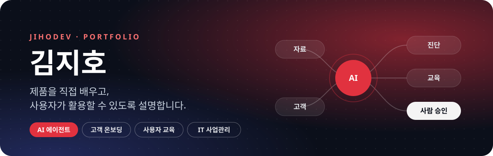
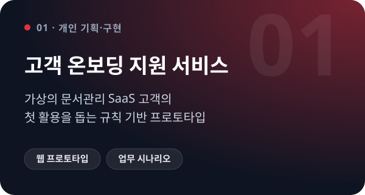
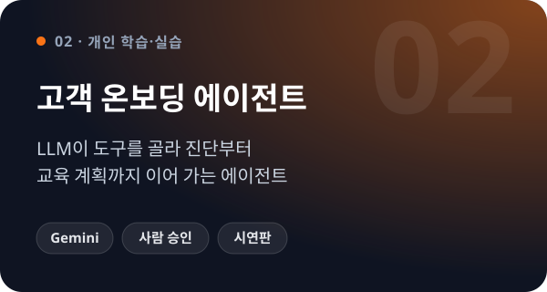
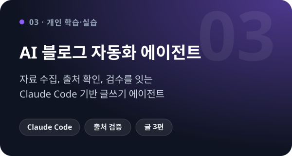
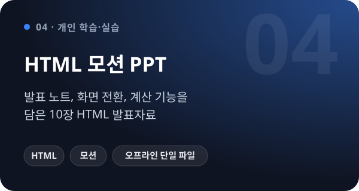
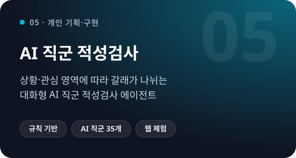

 

  

 

> 서버·솔루션 지원과 공공기관 IT 사업관리, 사용자 교육 경험을 바탕으로 **AI 에이전트**와 **업무용 발표자료**를 만들며 학습하고 있습니다.

 

## 🚀 Projects

<!-- 프로젝트 추가: .github/assets/cards.mjs 의 cards 배열에 항목을 넣고 node .github/assets/cards.mjs 실행 → 아래 표에 <td> 칸 하나 추가 (한 줄에 2칸) -->

<table>
  <tr>
    <td width="50%" valign="top">
      
      

        <a href="https://firstmile-onboarding-1104.day1companyk-6083.chatgpt.site/"><b>웹 체험 ↗</b></a> &nbsp;·&nbsp;
        <a href="%EA%B8%B0%EC%97%85%EC%9A%A9%20%ED%81%B4%EB%9D%BC%EC%9A%B0%EB%93%9C%20%EB%AC%B8%EC%84%9C%EA%B4%80%EB%A6%AC%20%EC%98%A8%EB%B3%B4%EB%94%A9%20%EC%84%9C%EB%B9%84%EC%8A%A4%20%EA%B0%9C%EB%B0%9C/portfolio/jihodev-onboarding-portfolio.pptx?raw=true"><b>6장 PPT</b></a> &nbsp;·&nbsp;
        <a href="%EA%B8%B0%EC%97%85%EC%9A%A9%20%ED%81%B4%EB%9D%BC%EC%9A%B0%EB%93%9C%20%EB%AC%B8%EC%84%9C%EA%B4%80%EB%A6%AC%20%EC%98%A8%EB%B3%B4%EB%94%A9%20%EC%84%9C%EB%B9%84%EC%8A%A4%20%EA%B0%9C%EB%B0%9C/"><b>폴더</b></a>
      

    </td>
    <td width="50%" valign="top">
      
      

        <a href="https://jihosw.github.io/jiho-agent/onboarding-agent/"><b>▶ 프로그램 보기</b></a> &nbsp;·&nbsp;
        시연 <a href="https://jihosw.github.io/jiho-agent/onboarding-agent/?play=hanbit">한빛물류</a> ·
        <a href="https://jihosw.github.io/jiho-agent/onboarding-agent/?play=greenfood">그린푸드</a> ·
        <a href="https://jihosw.github.io/jiho-agent/onboarding-agent/?play=seum">세움건설</a>
      

    </td>
  </tr>
  <tr>
    <td width="50%" valign="top">
      
      

        <a href="ai%20%EB%B8%94%EB%A1%9C%EA%B7%B8%20%EC%9E%90%EB%8F%99%ED%99%94%20%EC%97%90%EC%9D%B4%EC%A0%84%ED%8A%B8/portfolio/AI%20%EB%B8%94%EB%A1%9C%EA%B7%B8%20%EC%9E%90%EB%8F%99%ED%99%94%20%EC%97%90%EC%9D%B4%EC%A0%84%ED%8A%B8%20%ED%8F%AC%ED%8A%B8%ED%8F%B4%EB%A6%AC%EC%98%A4.pptx?raw=true"><b>6장 PPT</b></a> &nbsp;·&nbsp;
        <a href="ai%20%EB%B8%94%EB%A1%9C%EA%B7%B8%20%EC%9E%90%EB%8F%99%ED%99%94%20%EC%97%90%EC%9D%B4%EC%A0%84%ED%8A%B8/portfolio/AI%20%EB%B8%94%EB%A1%9C%EA%B7%B8%20%EC%9E%90%EB%8F%99%ED%99%94%20%EC%97%90%EC%9D%B4%EC%A0%84%ED%8A%B8%20%ED%8F%AC%ED%8A%B8%ED%8F%B4%EB%A6%AC%EC%98%A4.pdf"><b>PDF</b></a> &nbsp;·&nbsp;
        <a href="ai%20%EB%B8%94%EB%A1%9C%EA%B7%B8%20%EC%9E%90%EB%8F%99%ED%99%94%20%EC%97%90%EC%9D%B4%EC%A0%84%ED%8A%B8/"><b>폴더</b></a>
      

    </td>
    <td width="50%" valign="top">
      
      

        <a href="https://jihosw.github.io/jiho-agent/"><b>▶ 바로 보기</b></a> &nbsp;·&nbsp;
        <a href="html%20%EB%AA%A8%EC%85%98%20ppt/"><b>폴더</b></a>
      

    </td>
  </tr>
  <tr>
    <td width="50%" valign="top">
      
      

        <a href="https://jihosw.github.io/jiho-agent/career-agent/"><b>▶ 검사해 보기</b></a> &nbsp;·&nbsp;
        <a href="ai%20%EC%A7%81%EA%B5%B0%20%EC%A0%81%EC%84%B1%EA%B2%80%EC%82%AC%20%EC%97%90%EC%9D%B4%EC%A0%84%ED%8A%B8/"><b>폴더</b></a>
      

    </td>
    <td width="50%" valign="top"></td>
  </tr>
</table>

<b>프로젝트 자세히 보기</b>

 

| 프로젝트 | 내용 |
| --- | --- |
| **jihodev 고객 온보딩 지원 서비스** | 가상의 문서관리 SaaS를 도입한 고객의 첫 활용을 돕는 규칙 기반 업무 프로토타입입니다. |
| **고객 온보딩 에이전트** | 새 고객사를 맡기면 LLM(Gemini)이 도구를 골라 실행하며 진단, 원인 분석, 고객 안내, 개발 이슈 등록, 교육 계획, 첫 활용 목표까지 이어 갑니다. 설정 변경·고객 메일·개발 이슈는 사람이 승인해야 실행됩니다. |
| **AI 블로그 자동화 에이전트** | 공개 자료 수집, 동향 요약·분석 글 작성, 출처 확인과 검수를 연결하는 Claude Code 기반 실습입니다. 최종 주제와 발행 여부는 사람이 결정합니다. 분석 글 2편과 동향 요약 1편을 완성했습니다. |
| **HTML 모션 PPT** | 발표 노트와 화면 전환, 가정 기반 계산 기능을 포함한 10장 HTML 발표자료입니다. 오프라인에서 여는 단일 HTML도 제공합니다. |
| **AI 직군 적성검사** | 현재 상황과 관심 AI 영역에 따라 질문 갈래가 나뉘는 대화형 검사입니다. 약 40문항으로 역량·직업가치관·업무 스타일을 분석해 AI 직군 35개 중 TOP 5와 준비 로드맵을 추천합니다. 서버 없이 규칙 기반으로 동작하며 결과 링크 공유와 이미지·PDF 저장을 지원합니다. |

**그 밖의 자료** &nbsp; 📄 [개발 포트폴리오 PDF](portfolio/%EA%B0%9C%EB%B0%9C%20%ED%8F%AC%ED%8A%B8%ED%8F%B4%EB%A6%AC%EC%98%A4.pdf) &nbsp;·&nbsp; 🎓 [시스템 사용자 교육자료](portfolio/training/) (국립문화유산연구원 연구자원 통합관리시스템 교육자료, ECM 교육 대본)

AI·HTML 프로젝트는 개인 학습과 실습을 위한 작업물이며, 관련 기업의 공식 서비스나 공식 제안서가 아닙니다.

 

## 💼 Experience

<table>
  <tr>
    <td width="150" valign="top"><b>2025 – 2026</b></td>
    <td valign="top">
      <b>아이리스닷넷</b> · IT 사업관리 및 사용자 교육  
      • 국립문화유산연구원 사업의 일정관리, 고객 요청 정리, 개발자 협의, 테스트·검수 및 보고 등 PL·PMO 관련 실무 
      • RFP 분석, 제안서 작업과 산출물 정리, 고객 미팅 참여 
      • 이용자 교육자료 <b>44장과 발표 대본 직접 작성</b>, 각 지방소 이용자 <b>약 300명 대상 교육과 기능 시연</b> 
      • 테스트 이슈를 엑셀과 오류 화면 캡처 PPT로 정리해 PM·개발자와 공유하고 수정 과정에 참여
    </td>
  </tr>
  <tr>
    <td width="150" valign="top"><b>2024</b></td>
    <td valign="top">
      <b>엔엔소프트</b> · 솔루션지원팀  
      • Linux 서버 관리·구축·고도화와 Oracle DB 설치·운영 
      • 고객의 기술 문의 대응과 시스템 사용 안내
    </td>
  </tr>
</table>

 

## 🛠 Skills

| | |
| --- | --- |
| **실무** |       |
| **개발** |       |
| **AI 활용** |      |

 

## 🎓 Education & Certificates

| 기간 | 과정 |
| --- | --- |
| 2026.10 – 2027.01 | **CJ올리브네트웍스 L.L.M Academy** · AX 과정 수강 중 (수료 예정) |
| 2023.07 – 2024.02 | **대덕인재개발원** · 전자정부 표준 프레임워크 기반 풀스택 개발자 과정 |
| | 컴퓨터네트워크 전공 · 전문학사 졸업 |

  

 

## 🎯 Interests

`AI·SaaS 제품의 도입과 활용 지원` &nbsp; `고객 온보딩과 사용자 교육` &nbsp; `AI를 활용한 자료 제작과 정보 정리` &nbsp; `AX 교육·IT 사업운영`

 

학습과 경력 정보는 2026년 11월 기준입니다.

