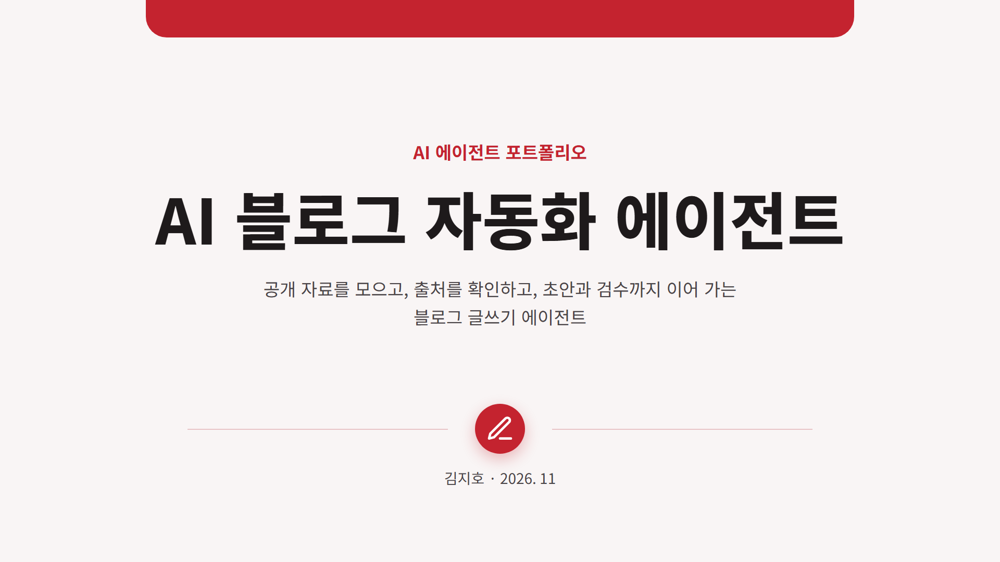
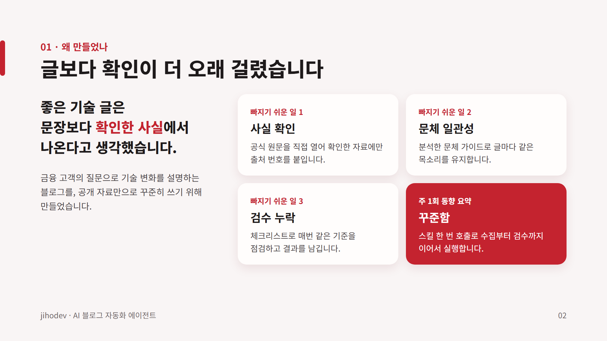
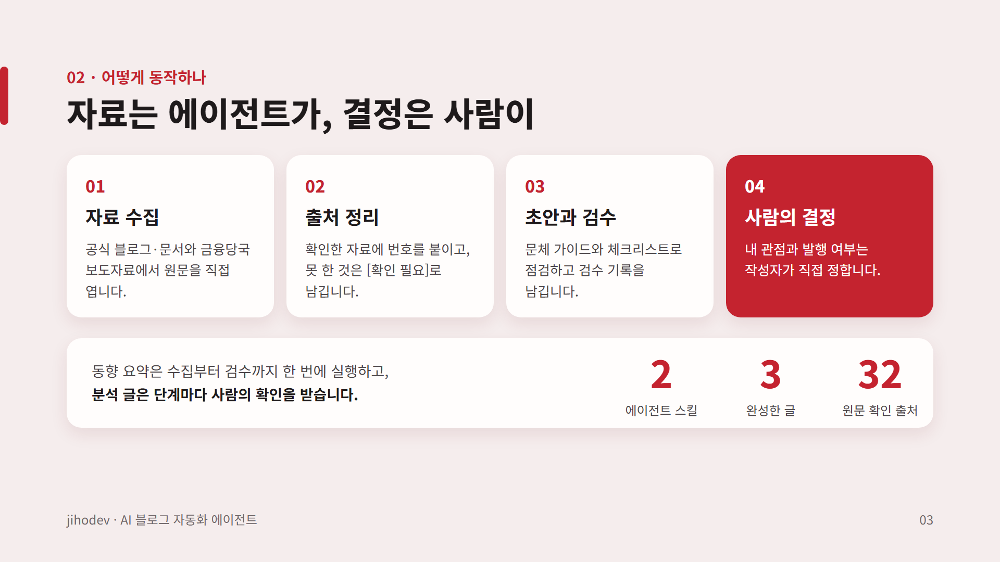
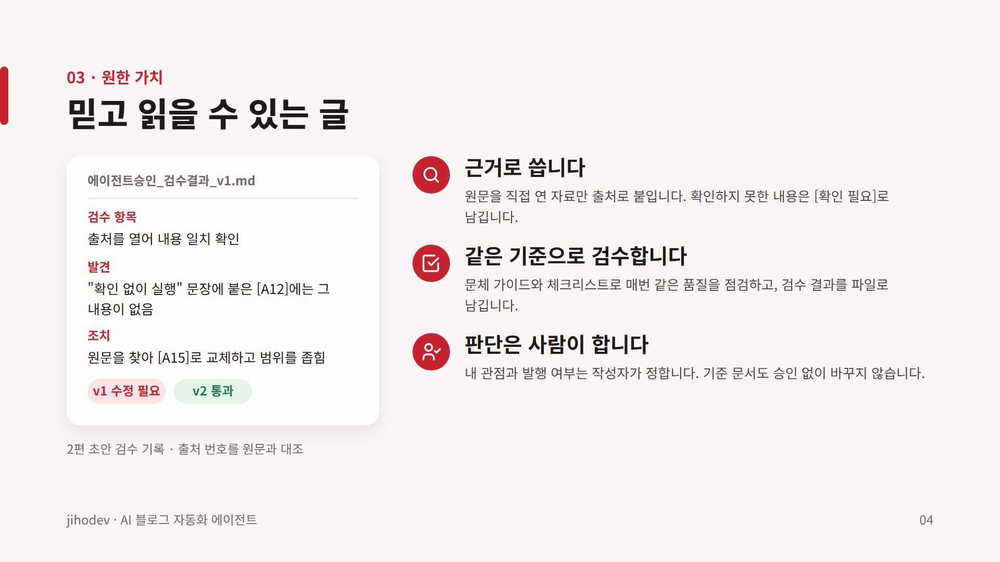
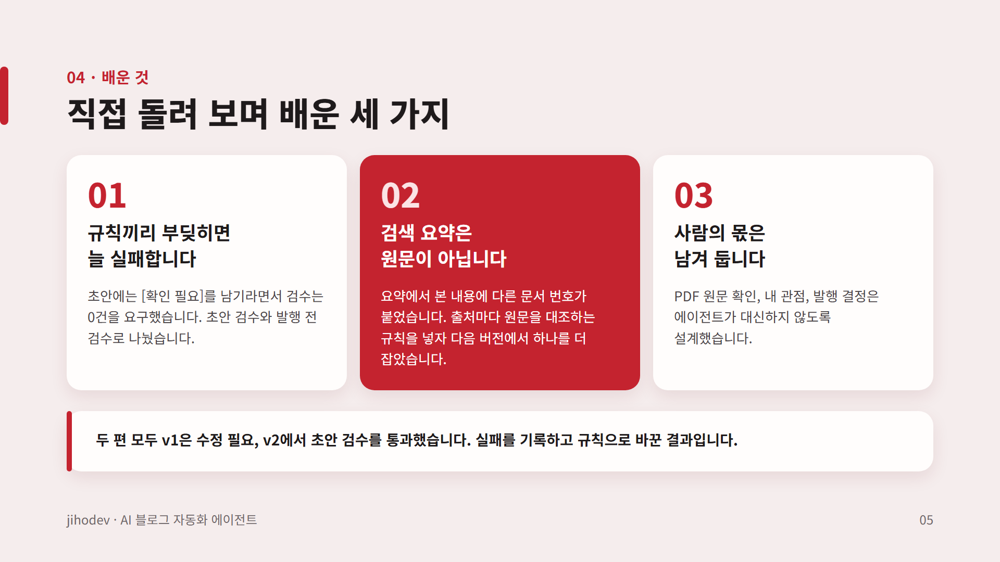
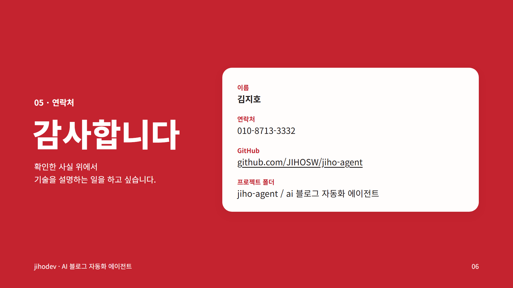

# jihodev · AI 블로그 자동화 에이전트

공개 자료를 모으고, 출처를 확인하고, 초안과 검수까지 이어 가는 **Claude Code 기반 블로그 글쓰기 에이전트**입니다.
에이전트는 자료 조사, 출처 정리, 초안 작성, 체크리스트 검수를 맡고, **내 관점과 발행 여부는 사람이 결정**합니다.

> 개인 학습·실습용 비공식 프로젝트입니다. 특정 회사의 공식 블로그나 공식 입장이 아니며, 공개 자료만 사용합니다.

## 포트폴리오

**[6장 PPT 다운로드](portfolio/AI%20%EB%B8%94%EB%A1%9C%EA%B7%B8%20%EC%9E%90%EB%8F%99%ED%99%94%20%EC%97%90%EC%9D%B4%EC%A0%84%ED%8A%B8%20%ED%8F%AC%ED%8A%B8%ED%8F%B4%EB%A6%AC%EC%98%A4.pptx?raw=true)** · **[📄 PDF 보기](portfolio/AI%20%EB%B8%94%EB%A1%9C%EA%B7%B8%20%EC%9E%90%EB%8F%99%ED%99%94%20%EC%97%90%EC%9D%B4%EC%A0%84%ED%8A%B8%20%ED%8F%AC%ED%8A%B8%ED%8F%B4%EB%A6%AC%EC%98%A4.pdf)**

왜 만들었는지, 어떻게 동작하는지, 어떤 가치를 원했고 무엇을 배웠는지 정리했습니다. 각 슬라이드의 발표자 노트에 설명 대본이 들어 있습니다.

1920×1080 기준으로 Noto Sans KR의 Regular·Bold·ExtraBold만 사용했고, 가장 작은 글자도 24px입니다. PPT를 다른 컴퓨터에서 편집할 때는 [Google Fonts](https://fonts.google.com/noto/specimen/Noto+Sans+KR)에서 Noto Sans KR을 설치해 주세요. PDF에는 글꼴이 들어 있습니다.








## 결과물

| 구분 | 내용 | 위치 |
|---|---|---|
| 분석 글 1편 | 서울 리전 내 추론이 바꾸는 금융 고객의 질문 | [06_발행](06_발행/) |
| 분석 글 2편 | AI 에이전트의 사람 승인 지점, 어디에 둘까 | [06_발행](06_발행/) |
| 동향 요약 | 2026-11-02 호, 공식 발표 4건 | [03_동향/2026-11-02](03_동향/2026-11-02/) |
| 출처 | 원문을 직접 열어 확인한 출처 32건, 확인 필요 항목 18건 | [04_출처](04_출처/) |
| 검수 기록 | 글마다 초안 v1~v3과 검수 결과 | [05_초안](05_초안/) |

## 동작 방식

두 트랙으로 운영합니다.

| 트랙 | 호출 | 진행 방식 |
|---|---|---|
| 동향 요약 (주 1회) | `/blog-trend [기준일]` | 공식 소스에서 직전 7일 발표를 모아 출처·초안·검수까지 한 번에 실행하고 결과만 보고 |
| 분석 글 | `/blog-analysis <주제>` | 주제와 질문 → 조사 계획 → 조사 → 초안 → 초안 검수 → 발행 전 검수, 단계마다 사람 확인 |

품질을 지키는 장치는 다음과 같습니다.

- **원문 확인**: 직접 연 공식 자료에만 출처 번호를 붙이고, 출처 번호가 붙은 문장은 그 번호의 원문과 하나씩 대조합니다.
- **미확인 표시**: 확인하지 못한 내용은 `[확인 필요: X번호]`로 남기고 목록에 올립니다.
- **두 단계 검수**: 초안 검수와 발행 전 검수를 나눕니다. 발행 전에는 `[확인 필요]`가 0건이어야 합니다.
- **사람의 결정**: 내 관점, 일반 정의 확인, 발행 여부는 작성자가 정합니다. 에이전트는 블로그에 로그인하거나 게시하지 않고, 기준 문서도 승인 없이 바꾸지 않습니다.

## 폴더 구성

| 폴더 | 내용 |
|---|---|
| `.claude/skills/` | 스킬 2개: `blog-trend`, `blog-analysis` |
| `00_기준문서/` | 프로젝트 개요, 문체 가이드, SEO 가이드, 검수 체크리스트 2종, 수집 소스 |
| `01_참고자료/` | 작업 중 참고한 자료 (출처 근거로는 쓰지 않음) |
| `02_템플릿/` | 동향 요약·분석 글 템플릿 |
| `03_동향/` | 주간 동향 요약 (날짜별) |
| `04_출처/` | 분석 글 출처 목록과 확인 필요 목록 |
| `05_초안/` | 버전별 초안과 검수 결과 |
| `06_발행/` | 최종본, 블로그 붙여넣기용 평문, 발행 메모 |
| `portfolio/` | 6장 포트폴리오 PPT·PDF·슬라이드 이미지와 생성 스크립트 |

## 사용법

1. Claude Code를 **이 폴더에서** 엽니다. 상위 폴더에서 열면 스킬이 인식되지 않습니다.
2. 동향 요약은 `/blog-trend`, 분석 글은 `/blog-analysis <주제>`로 시작합니다.
3. 결과는 `06_발행/`의 붙여넣기용 파일과 발행 메모를 보고 블로그에 직접 올립니다.

## 개선 기록

검수에서 드러난 실패를 규칙으로 바꿔 왔습니다. 검수 체크리스트는 1.0에서 1.3까지 세 번 고쳤습니다.

| 버전 | 바꾼 것 | 계기 |
|---|---|---|
| 1.1 | 초안 검수와 발행 전 검수 분리 | 초안에는 `[확인 필요]`를 남기라면서 검수는 0건을 요구하던 규칙 충돌 |
| 1.2 | 미확인 표시에 목록 번호, 소제목 형식 | 표시와 목록을 맞춰 보기 어려움 |
| 1.3 | 출처 번호와 원문 페이지 대조 | 검색 요약에서 본 내용에 다른 문서의 출처 번호가 붙은 오류 |

## 한계

- 블로그 게시는 사람이 직접 합니다.
- 한글 글꼴에 문자 정보가 없는 PDF(예: 일부 정부 첨부 문서)는 텍스트를 뽑지 못해, 해당 내용은 사람이 확인해야 합니다.
- 예약 실행은 아직 설정하지 않았습니다. 동향 요약은 직접 호출합니다.

## 포트폴리오 다시 만들기

`portfolio/src/`의 `deck.mjs`(슬라이드 배치)와 `render.mjs`(HTML·PDF·PNG·PPTX 생성)로 다시 만들 수 있습니다. Node.js, Microsoft Edge, `pptxgenjs` 3.12.0, Windows에 설치된 Noto Sans KR이 필요합니다.

```text
node portfolio/src/render.mjs <pptxgenjs를 설치한 폴더> <출력 폴더>
```
