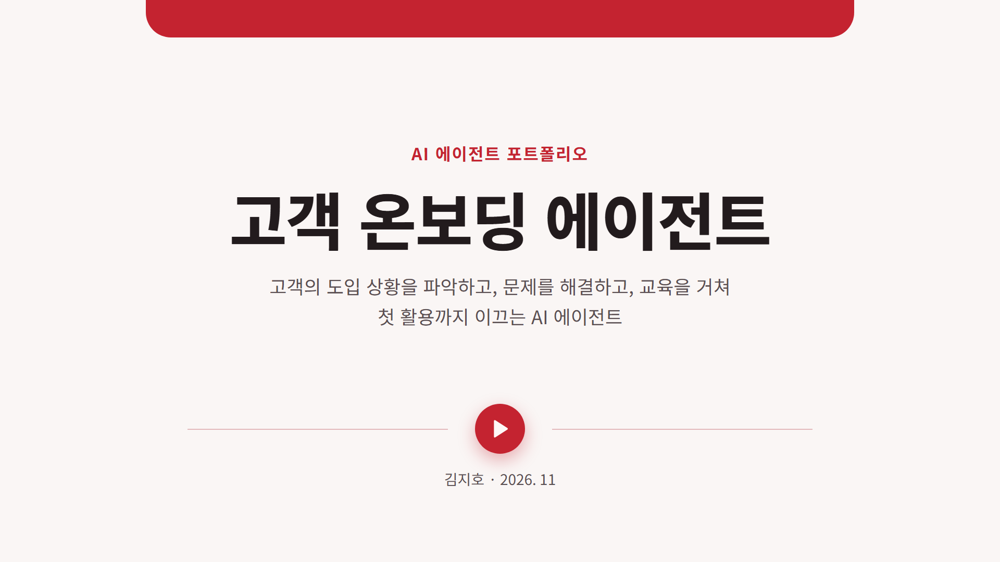
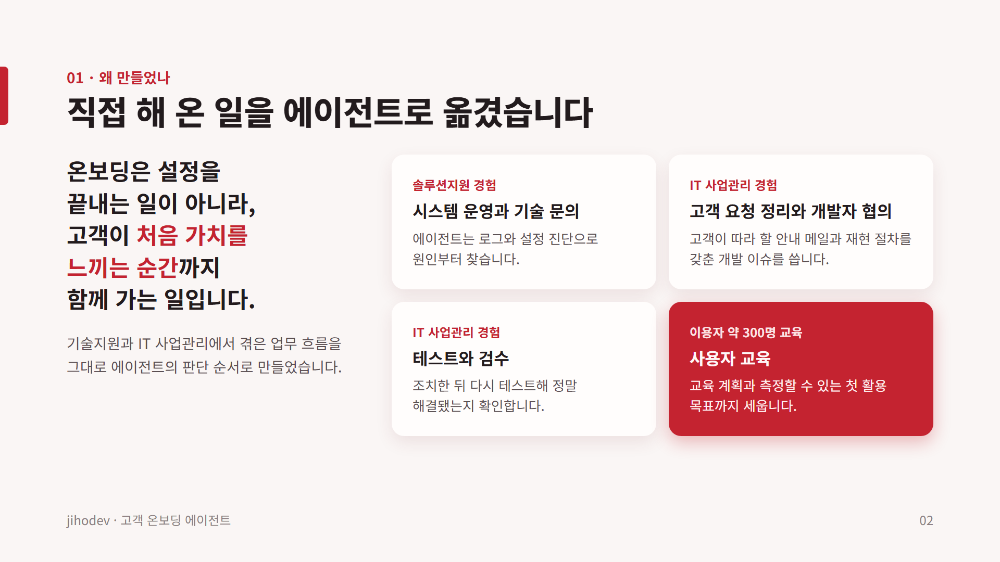
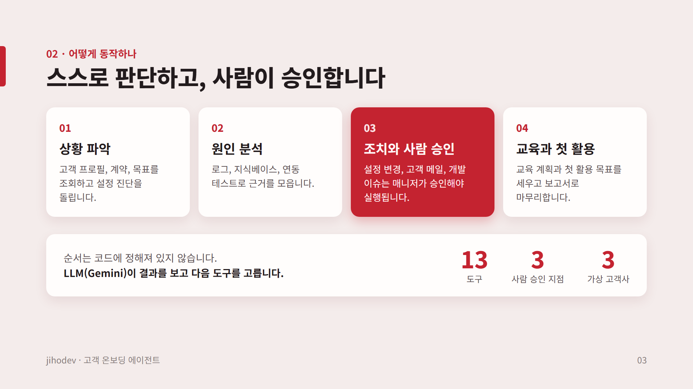
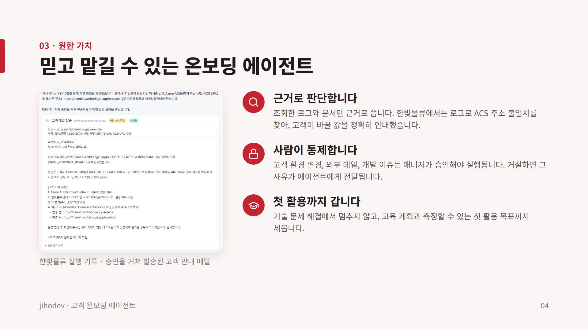
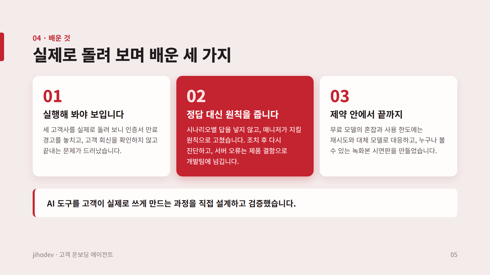
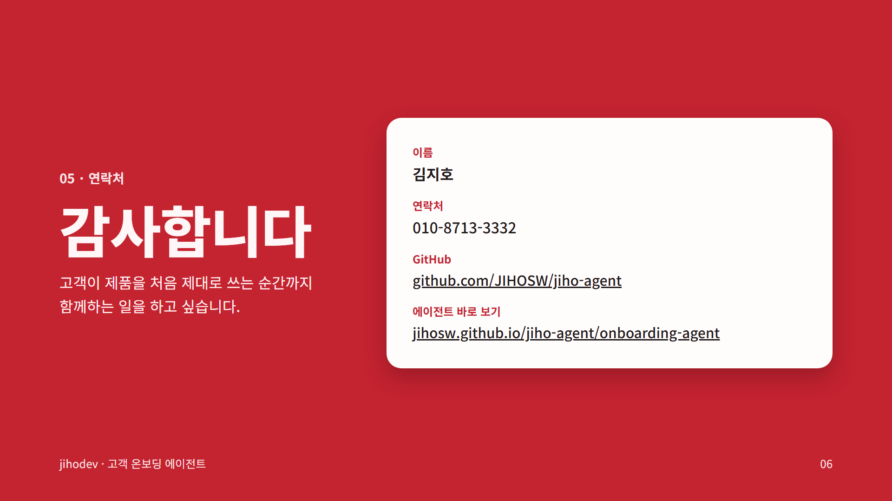
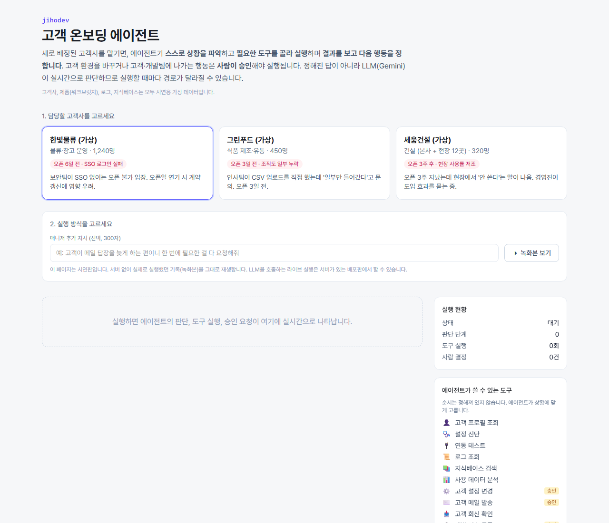
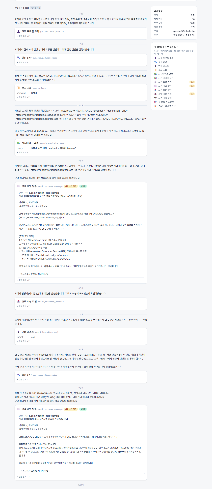

# jihodev · 고객 온보딩 에이전트

새로 배정된 고객사를 맡기면 LLM(Google Gemini)이 **목표를 이해하고, 필요한 도구를 골라 실행하고, 결과를 보고 다음 행동을 정해서** 고객을 첫 활용까지 이끄는 온보딩 에이전트입니다.
미리 써둔 분석 결과를 보여주는 화면이 아니라, 실행할 때마다 에이전트가 실제로 판단합니다.

> 고객사, 제품(워크브릿지), 로그, 지식베이스는 모두 시연용 가상 데이터입니다.

## 포트폴리오

**[📄 포트폴리오 PDF 보기 (6장)](portfolio/고객%20온보딩%20에이전트%20포트폴리오.pdf)** — 왜 만들었는지, 어떻게 동작하는지, 어떤 가치를 원했고 무엇을 배웠는지 정리했습니다.








## 바로 보기

**[▶ 프로그램 바로 열기](https://jihosw.github.io/jiho-agent/onboarding-agent/)** — 설치 없이 브라우저에서 열립니다.

시연 녹화본은 에이전트를 실제로 실행했던 기록을 그대로 재생합니다. 링크를 누르면 바로 재생이 시작됩니다.

| 고객사 | 상황 | 녹화본 |
|---|---|---|
| 한빛물류 | 오픈 6일 전, SSO 로그인 실패 | [▶ 재생](https://jihosw.github.io/jiho-agent/onboarding-agent/?play=hanbit) |
| 그린푸드 | 오픈 3일 전, 조직도 일부 누락 | [▶ 재생](https://jihosw.github.io/jiho-agent/onboarding-agent/?play=greenfood) |
| 세움건설 | 오픈 3주 후, 현장 사용률 저조 | [▶ 재생](https://jihosw.github.io/jiho-agent/onboarding-agent/?play=seum) |

공개 페이지는 서버가 없는 시연판이라 녹화본만 재생합니다. LLM을 직접 호출하는 라이브 실행은 [로컬 실행](#로컬-실행)이나 [배포](#배포-vercel)한 서버에서 할 수 있습니다.



<details>
<summary>한빛물류 녹화본 화면 (진단 → 원인 분석 → 고객 메일 승인 → 재검증)</summary>



</details>

## 왜 만들었나

고객 온보딩은 "설정해 주고 끝"이 아니라 아래 과정을 끝까지 이어가는 일입니다.

| 온보딩 업무 | 에이전트에서 대응하는 부분 |
|---|---|
| 도입 상황 파악 | 고객 프로필·계약·목표 조회, 설정 진단 |
| 기술 문의 대응, 원인 분석 | 로그 조회, 지식베이스 검색, 연동 테스트로 재검증 |
| 고객 요청 정리 | 고객이 그대로 따라 할 수 있는 조치 안내 메일 |
| 개발자 협의 | 재현 절차·근거·영향·우회책을 갖춘 개발 이슈 등록 |
| 테스트·검수 | 조치 후 연동 테스트로 해결 여부 확인 |
| 사용자 교육 | 사용 데이터에서 가장 덜 쓰는 핵심 대상을 찾아 교육 계획 수립 |
| 첫 활용 | 측정 가능한 첫 활용 목표(지표·날짜) 등록 |

## 고객 시나리오 3개

같은 에이전트가 고객마다 전혀 다른 경로로 움직입니다.

| 고객사 | 상황 | 에이전트가 찾아내야 하는 것 |
|---|---|---|
| 한빛물류 | 오픈 6일 전, SSO 로그인 실패 | 원인은 고객 IdP의 ACS URL. 우리가 고칠 수 없어서 **고객에게 정확한 값을 안내**해야 함. 모호하게 쓰면 고객이 되묻습니다. 인증서 만료 임박도 함께 발견해야 함 |
| 그린푸드 | 오픈 3일 전, 조직도 일부 누락 | 인코딩 문제(지식베이스로 해결)와 **제품 결함**(부서명 괄호 → HTTP 500, 문서 없음)이 섞여 있음. 하나를 고친 뒤 재검증해야 나머지가 보이고, 결함은 개발 이슈와 우회책으로 처리 |
| 세움건설 | 오픈 3주 후, 현장 사용률 저조 | 진단은 모두 정상. 사용 데이터와 로그를 봐야 **현장 계정 23개 잠김**과 일일보고 양식 부재가 드러남. 교육과 첫 활용 목표까지 연결 |

## 동작 방식

```
매니저: "이 고객을 첫 활용까지 데려가 줘"
      │
      ▼
┌──────────── 에이전트 루프 (src/lib/agent.ts) ────────────┐
│ LLM이 다음 행동 결정 ─▶ 도구 호출                        │
│        ▲                     │                           │
│        │          읽기 도구 ─▶ 바로 실행 ─▶ 결과 반환 ───┤
│        │          승인 도구 ─▶ 사람 승인 대기 ─▶ 승인/거절│
│        └──────── 결과를 보고 다시 판단 ◀─────────────────┘
│ 보고서 제출(submit_onboarding_report)하면 종료           │
└──────────────────────────────────────────────────────────┘
```

- **도구 13개** (`src/lib/tools.ts`): 프로필 조회, 설정 진단, 연동 테스트, 로그 조회, 지식베이스 검색, 사용 분석, 설정 변경, 고객 메일, 회신 확인, 개발 이슈, 교육 계획, 첫 활용 목표, 보고서. 순서는 코드에 정해져 있지 않고 모델이 고릅니다.
- **사람 승인 지점**: 고객 환경을 바꾸는 `apply_config_change`, 회사 밖으로 나가는 `send_customer_message`, 다른 팀에 일을 만드는 `create_dev_ticket`는 담당 매니저가 화면에서 승인해야 실행됩니다. 거절하면 사유가 에이전트에게 전달되고, 에이전트가 다른 방법을 찾습니다.
- **가상 고객 환경** (`src/lib/scenarios.ts`): 승인된 조치는 환경 상태를 실제로 바꾸고, 고객 회신은 보낸 메일의 내용에 따라 달라집니다.
- **실시간 화면**: 단계별 설명, 도구 입력과 결과, 승인 요청을 스트리밍으로 보여줍니다.

## 실제로 돌려보며 고친 것

세 고객사를 실제로 실행해 보고, 에이전트가 놓친 부분을 "정답"이 아니라 온보딩 매니저의 일반 원칙으로 보완했습니다.

| 실행에서 드러난 문제 | 보완한 원칙·장치 |
|---|---|
| SSO를 고친 뒤 오픈 전날 만료되는 인증서를 놓침 | 조치 후 진단을 다시 돌려 남은 경고까지 검수 |
| HTTP 500 제품 결함을 고객 데이터 문제로 처리하고, 확인되지 않은 패치 일정을 약속함 | 서버 오류는 결함 신호로 보고 개발 이슈로 넘김, 확인 안 된 일정은 약속 금지 |
| 필요한 결재 양식이 없는데 그 양식을 쓰는 교육을 계획함 | 교육·목표 전에 필요한 기능이 준비돼 있는지 먼저 확인 |
| 고객 회신(교육 가능 시간 제약)을 확인하지 않고 종료 | 메일을 보냈으면 회신을 확인하고 반영한 뒤 보고 |
| 기술 문제만 해결하고 교육·첫 활용 목표 없이 보고 | 보고서 제출 체크리스트: 없으면 첫 제출 반려 |
| 조회하지 않은 문서 번호를 근거로 적음 | 근거는 실제로 조회한 문서·로그만 |

`public/replays/`의 녹화본은 이 보완 후 실제로 실행한 기록입니다. 승인 단계는 개발자가 매니저 역할로 내용을 검토해 결정했습니다.

## 기술 구성

- Next.js 15 (App Router) + TypeScript + Tailwind CSS
- Google Gen AI SDK, 기본 모델 `gemini-3.6-flash`(무료 요금제), 직접 작성한 function calling 루프
- 무료 모델은 혼잡(503)과 분당 한도(429)가 잦아, 짧게 재시도한 뒤 다른 무료 모델(`gemini-3.8-flash`, `gemini-3.5-flash-lite`)로 넘어가고 그 실행은 넘어간 모델로 끝까지 진행합니다
- 도구 정의는 모델 제공사와 무관한 JSON Schema라서, 두뇌 호출부(`src/lib/agent.ts`)만 바꾸면 다른 LLM으로 교체할 수 있습니다
- 서버에 상태를 저장하지 않는 구조: 승인 대기 시점의 실행 상태를 HMAC으로 서명해 브라우저에 맡기고, 재개할 때 서명을 검증합니다. Vercel 같은 서버리스에 그대로 배포됩니다.
- 공개 데모 보호: IP별·일별 실행 횟수 제한, 실행당 최대 단계 수, 같은 승인 상태 재사용 차단

## 로컬 실행

```bash
npm install
cp .env.example .env.local   # GEMINI_API_KEY, STATE_SECRET 입력
npm run dev
```

http://localhost:3000 에서 고객사를 고르고 **라이브 실행**을 누릅니다.

## 녹화본 만들기

라이브 실행이 끝나면 오른쪽 **실행 기록 내려받기** 버튼으로 JSON을 받아 `public/replays/{hanbit|greenfood|seum}.json`에 넣으면, 방문자가 API 비용 없이 **녹화본 보기**로 실제 실행 과정을 재생할 수 있습니다.

## 시연판 빌드 (GitHub Pages)

```bash
node scripts/build-demo.mjs
```

서버 API를 뺀 정적 페이지를 `demo-dist/`에 만듭니다. 이 폴더가 main에 올라가면 GitHub Actions가 `https://jihosw.github.io/jiho-agent/onboarding-agent/`로 게시합니다. `?play=hanbit`처럼 주소에 고객사를 붙이면 해당 녹화본이 바로 재생됩니다.

## 배포 (Vercel)

1. 이 저장소를 Vercel에 가져오기(Import)
2. 환경 변수 `GEMINI_API_KEY`, `STATE_SECRET` 설정
3. 무료 요금제는 하루 요청 수에 한도가 있습니다. 한도를 넘으면 그날은 라이브 실행이 멈추고 녹화본은 계속 볼 수 있습니다
