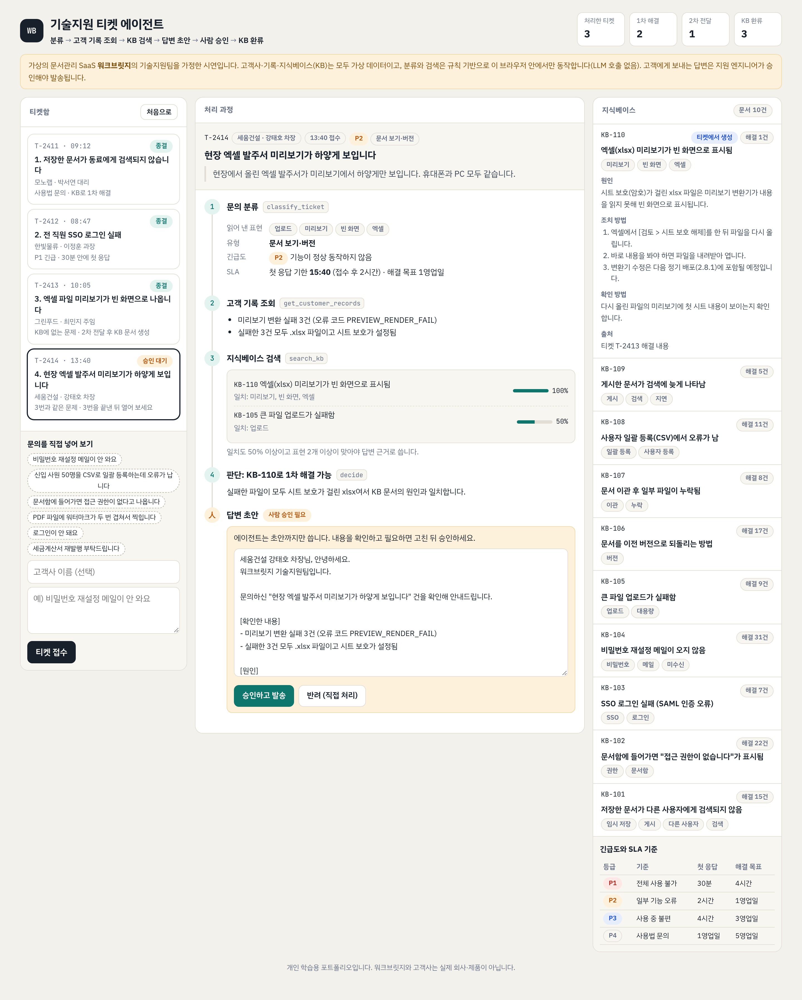

# 기술지원 티켓 에이전트

고객 문의가 들어오면 **분류 → 고객 기록 조회 → KB 검색 → 답변 초안 → 사람 승인 → KB 환류**까지 이어 가는 기술지원 1차 대응 에이전트 시연입니다.

> 가상의 문서관리 SaaS "워크브릿지"의 기술지원팀을 가정했습니다. 고객사·기록·지식베이스(KB)는 모두 가상 데이터입니다.
> 분류와 검색은 규칙 기반으로 브라우저 안에서만 동작하며 LLM을 호출하지 않습니다.

## 바로 보기

**[▶ 시연 열기](https://jihosw.github.io/jiho-agent/support-agent/)** — 설치 없이 브라우저에서 열립니다. `index.html`을 내려받아 열어도 똑같이 동작합니다.

| 티켓 | 상황 | 에이전트의 처리 | 바로 재생 |
|---|---|---|---|
| 1. 모노랩 | 저장한 문서가 동료에게 검색되지 않음 | KB-101로 1차 해결 | [▶](https://jihosw.github.io/jiho-agent/support-agent/?play=1) |
| 2. 한빛물류 | 전 직원 SSO 로그인 실패 | P1로 분류, 30분 안에 첫 응답, 우회 방법 안내 | [▶](https://jihosw.github.io/jiho-agent/support-agent/?play=2) |
| 3. 그린푸드 | 엑셀 미리보기가 빈 화면 | KB에 없어 개발 이슈로 2차 전달, 해결 후 새 KB 문서 생성 | [▶](https://jihosw.github.io/jiho-agent/support-agent/?play=3) |
| 4. 세움건설 | 3번과 같은 증상 | 3번에서 만든 KB 문서로 1차 해결 | [▶](https://jihosw.github.io/jiho-agent/support-agent/?play=4) |

4번은 3번을 끝낸 뒤에 열어야 차이가 보입니다. 3번을 건너뛰면 4번도 2차로 넘어갑니다.
왼쪽 아래 입력란에 문의를 직접 써넣어도 같은 과정으로 처리합니다.

## 왜 만들었나

솔루션지원팀에서 고객 문의를 받을 때 반복하던 일을 순서대로 옮겼습니다.

| 기술지원 업무 | 에이전트에서 대응하는 부분 |
|---|---|
| 문의 접수, 우선순위 판단 | 유형 7가지와 긴급도 P1~P4 분류, SLA 첫 응답 기한 계산 |
| 고객 상황 확인 | 고객 기록(로그, 설정 변경 이력) 조회 |
| 기존 해결 사례 찾기 | KB 검색, 일치도와 일치한 표현 표시 |
| 고객 안내 | 확인한 내용·원인·조치·확인 방법 순서의 답변 초안 |
| 개발자 협의 | 증상·재현 절차·관련 기록·영향 범위를 갖춘 개발 이슈 |
| 해결 내용 문서화 | 해결된 티켓을 KB 문서로 등록, 기존 문서는 해결 건수 갱신 |

## 판단 기준

- **1차 해결**: KB 문서와 일치도 50% 이상, 일치한 표현 2개 이상일 때만 답변 근거로 씁니다.
- **확인 질문**: 문의에서 읽어 낸 내용이 부족하면 추측하지 않고 유형별 확인 질문을 먼저 보냅니다.
- **2차 전달**: 근거로 쓸 KB 문서가 없으면 개발 이슈를 등록하고 고객에게 접수 사실을 알립니다.
- **타 부서 전달**: 계약·요금 문의는 고객성공팀으로 넘깁니다.
- **사람 승인**: 고객에게 가는 모든 답변은 엔지니어가 확인·수정한 뒤 승인해야 발송됩니다. 반려하면 엔지니어가 직접 처리합니다.

## 구현 범위와 한계

- 서버와 빌드 없이 `index.html` 한 파일로 동작합니다. 처리 결과는 저장되지 않고 새로 고치면 처음 상태로 돌아갑니다.
- 분류는 표현 사전(같은 뜻의 여러 표현을 하나로 묶은 목록)에 기반합니다. 사전에 없는 표현은 읽지 못해 확인 질문으로 넘어갑니다.
- 메일 발송, 개발 이슈 등록, 고객 회신은 화면에만 표시되는 시연입니다. 실제 시스템과 연결되어 있지 않습니다.
- 실제 업무에 쓰려면 분류·초안 작성을 LLM으로 바꾸고, 티켓 시스템과 로그 조회를 연동해야 합니다.
