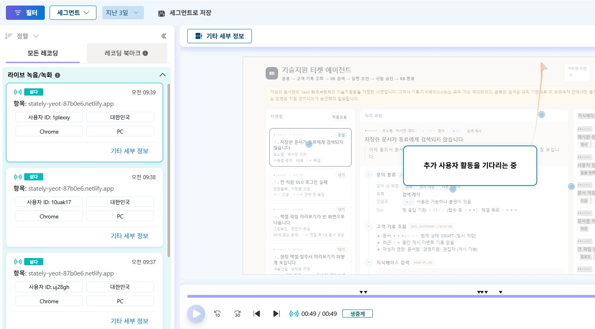
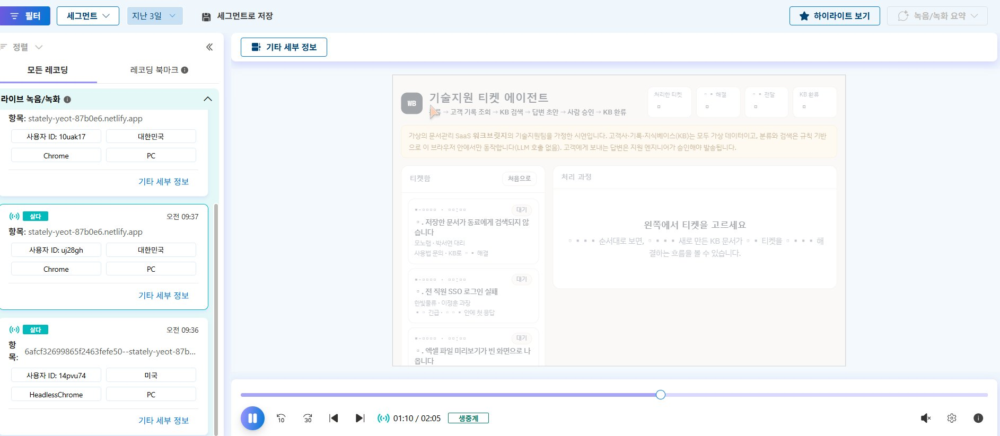

# 배포 후 사용 분석 (Microsoft Clarity)

만든 시연을 실제로 배포하고, 방문 기록을 보며 고칠 점을 찾은 과정입니다.

- **배포**: Netlify Drop(측정용)과 GitHub Pages(공개 시연)
- **기록 도구**: Microsoft Clarity. 방문자의 클릭·스크롤을 영상처럼 다시 보고, 직접 정한 이벤트를 집계합니다.
- **범위**: 아래 초기 관찰은 녹화 몇 건을 직접 본 결과이며, 통계로 일반화할 수 있는 양이 아닙니다. 그래서 이 문서는 관찰 → 가설 → 개선 → 측정 설계까지를 다루고, 숫자로 된 결론은 아직 내리지 않았습니다.

## 1. 초기 관찰 (2026년 11월, 녹화 4건)

| 녹화 | 환경 | 본 내용 |
|---|---|---|
| 1 | 대한민국 · Chrome · PC | 1번 티켓을 열어 분류 → 고객 기록 조회 → KB 검색까지 진행 (재생 49초) |
| 2 | 대한민국 · Chrome · PC | 2분 5초 중 1분 10초 시점에도 티켓을 고르지 않은 시작 화면에 머묾 |
| 3 | 대한민국 · Chrome · PC | 같은 주소 방문 |
| 4 | 미국 · HeadlessChrome · PC | Netlify 배포 미리보기 주소(`…--stately-yeot…`)에서 기록된 자동 방문 |

## 2. 발견한 문제와 개선

| 관찰 | 해석 | 개선 |
|---|---|---|
| 녹화에서 집계 숫자, 티켓 번호, 시각, 일부 문장이 점(•)으로 가려짐 | Clarity 기본 설정이 화면 글자를 가려서, 에이전트가 무엇을 판단했는지 녹화로 읽을 수 없음 | 가상 데이터만 있는 영역(티켓함, 처리 과정, KB)은 `data-clarity-unmask`로 보이게 하고, 방문자가 직접 쓰는 **티켓 추가 칸과 직접 입력한 티켓의 제목·내용은 `data-clarity-mask`로 계속 가림** |
| 한 녹화가 1분 넘게 시작 화면에 머묾 | 어디서 시작할지 분명하지 않을 수 있음. 다만 1건이라 단정할 수 없음 | 처리 과정 칸에 **[1번 티켓부터 시작]** 버튼 추가. 버튼 사용 여부를 `start_button` 이벤트로 확인 |
| HeadlessChrome 방문 | 사람이 아닌 배포 미리보기 확인용 자동 방문 | 분석할 때 HeadlessChrome과 배포 미리보기 주소는 제외 |
| 클릭과 스크롤만으로는 어디까지 진행했는지 숫자로 볼 수 없음 | 녹화를 하나씩 봐야 해서 방문이 늘면 비교가 어려움 | 처리 단계마다 사용자 지정 이벤트를 남기도록 코드 추가 (아래 3번) |
| 방문자가 기록되는지 알 수 없음 | 녹화 사실을 알리지 않으면 방문자가 모르고 이용함 | 화면 상단 안내문에 Clarity로 기록되며 직접 입력한 내용은 가려진다는 문장 추가 |

## 3. 측정 설계

알고 싶은 것을 먼저 정하고, 그것을 볼 수 있는 이벤트를 넣었습니다. 방문자가 입력한 글자는 보내지 않고 **분류 결과(유형, 긴급도)만** 보냅니다.

| 알고 싶은 것 | 보는 방법 | 이벤트·태그 |
|---|---|---|
| 방문자가 시연을 끝까지 보는가 | 깔때기: 방문 → 티켓 열기 → 종결 → 4건 완주 | `page_view` → `ticket_open_*` → `ticket_closed` → `all_scenarios_done` |
| 어디서 시작하는가 | 시작 버튼 사용률, 진입 경로 | `start_button`, 태그 `entry`(`direct` / `play_1`~`play_4`) |
| 에이전트 초안을 그대로 믿는가 | 승인 · 수정 후 승인 · 반려의 비율 | `draft_approved`, `draft_approved_edited`, `draft_rejected` |
| 직접 문의를 넣어 보는가, 어떤 문의인가 | 티켓 추가 수, 분류 결과 분포 | `ticket_added`, 태그 `category`, `priority` |
| 표현 사전이 부족한 문의가 얼마나 되는가 | 직접 입력 중 확인 질문으로 빠진 비율 | `asked_question` (높으면 사전 확장 우선순위) |
| KB 환류 흐름까지 보는가 | 2차 전달 대비 KB 생성 | `escalated`, `kb_created`, `first_line_solved` |
| 다시 방문하는가 | 저장된 진행 기록이 있는 방문 | 태그 `returning` |

### Clarity에서 보는 방법

1. **필터 → 사용자 지정 이벤트**에서 이벤트 이름을 고르면 그 이벤트가 있는 녹화만 볼 수 있습니다. 예: `draft_rejected`를 고르면 초안을 반려한 녹화만 봅니다.
2. **대시보드 → 깔때기**에 `page_view` → `ticket_open_T-2411` → `ticket_closed` → `all_scenarios_done`을 넣으면 단계별로 얼마나 남는지 봅니다.
3. **필터 → 사용자 지정 태그**에서 `category`, `priority`, `entry`, `outcome` 값별로 나눠 봅니다.
4. 분석 전에 **필터 → 브라우저**에서 HeadlessChrome을 제외합니다.

## 4. 다음에 할 일

- 방문이 쌓이면 위 표의 비율을 채우고, 반려·수정이 많은 초안 유형과 확인 질문으로 빠진 문의 유형을 골라 템플릿과 표현 사전을 고칩니다.
- `start_button` 도입 전후로 첫 티켓을 여는 데 걸리는 시간을 비교합니다.
- 숫자는 실제 집계가 나온 뒤에만 이 문서와 포트폴리오에 적습니다.
