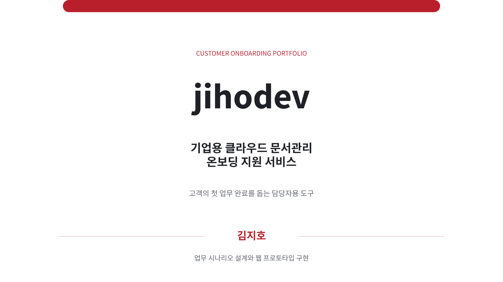
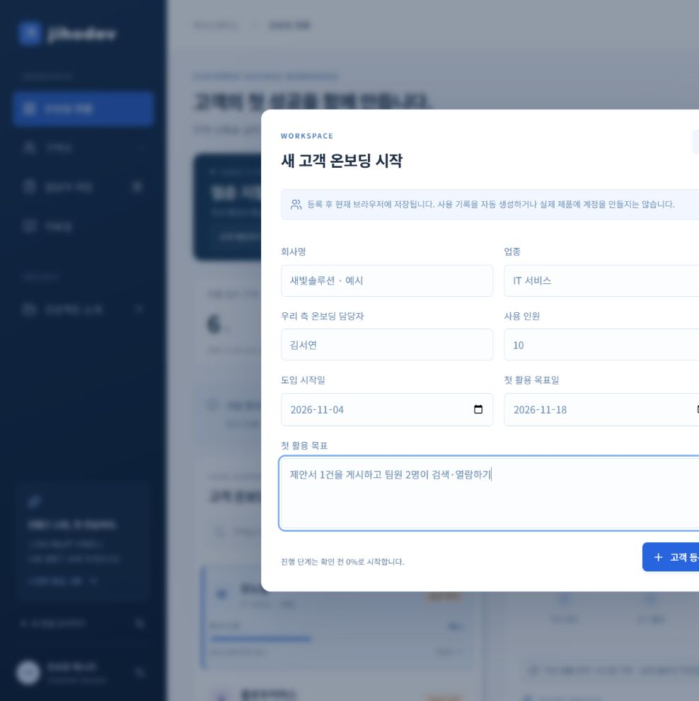

# 기업용 클라우드 문서관리 온보딩 서비스 개발

**jihodev — 고객의 첫 활용을 돕는 온보딩 담당자용 AI 업무 도구**

## 결과물 바로 보기

### [▶ 웹 서비스 바로 체험하기](https://firstmile-onboarding-1104.day1companyk-6083.chatgpt.site/)

로그인 없이 링크로 열 수 있는 공개 포트폴리오입니다. 설치 없이 고객 현황, 근거 확인, 안내문 작성, 작업 관리를 체험할 수 있습니다.

**현재 공개 버전은 가상 데이터와 규칙 기반 분석으로 동작합니다.** 실제 AI 분석은 서버 API 키 설정 후 사용할 수 있으며, 실제 고객 시스템·DB·로그에는 연결되어 있지 않습니다. 추가한 고객과 작업은 방문자 본인의 브라우저에 저장됩니다.

### 발표 포트폴리오

**[6장 PPT 다운로드](portfolio/jihodev-onboarding-portfolio.pptx?raw=true)**

기획 배경과 기대한 가치, 온보딩 프로세스, 구현 화면, 배운 점과 향후 개발 방향을 정리했습니다. 현재 구현 범위와 실제 AI·업무 시스템 연동의 한계도 함께 설명합니다. 각 슬라이드의 발표자 노트에는 발표 대본이 들어 있습니다.

1920×1080 기준으로 Noto Sans KR의 Regular·Bold·ExtraBold를 사용했습니다. 다른 컴퓨터에서 편집할 때는 해당 글꼴을 설치해 주세요.



### 프로젝트 문서

- [발표·시연 대본 읽기](대본.md)
- [가정한 솔루션과 전체 업무 프로세스](docs/PROCESS.md)
- [경력 연결·면접 설명](docs/PORTFOLIO.md)
- [검증 결과와 구현 한계](docs/VERIFICATION.md)



---

문서관리 SaaS의 고객 목표 확인 → 기록·문서 대조 → 다음 조치 → 안내문 → 담당자 작업을 연결하는 취업 포트폴리오입니다. 실제 경험에서 얻은 문제의식을 바탕으로 고객·제품·문의·로그를 가상으로 구성했습니다.

## 실행

로컬 실행은 Node.js 22.13 이상과 pnpm 11.25.0을 준비한 뒤 아래 명령을 실행합니다. 의존성을 설치한 Windows에서는 `실행.cmd`를 사용할 수도 있습니다. 서버 종료는 Ctrl+C입니다.

```text
pnpm install
pnpm dev
```

## 약 3분 체험

상단 **고객 추가**에서 회사명·업종·우리 측 담당자·사용 인원·도입일·목표일·첫 활용 목표를 등록할 수 있습니다. 새 고객은 실제 사용 기록이 없는 0% 상태로 시작합니다. 고객·연결된 작업·메모·안내문은 이 브라우저에 저장되며, 기존 저장 데이터도 유지됩니다. 고객 상태 필터의 ‘직접 등록’에서 새 고객을 모아 볼 수 있습니다.

이 앱은 가상의 클라우드 문서관리 서비스를 기업에 제공한 상황을 가정합니다. 솔루션 자체와 jihodev의 역할, 도입 전체 흐름, ‘게시 전 단계’를 확인하는 데이터 출처는 [프로세스·근거 설명](docs/PROCESS.md)에 정리했습니다. 화면의 ‘전체 프로세스’에서도 확인할 수 있습니다.

1. 모노랩의 첫 활용 목표와 현재 단계를 확인합니다.
2. 확인된 사실 옆 숫자로 원본 기록·가이드 문단을 엽니다.
3. ‘시연 기록’을 기본 기록 → 게시 후 검색 오류 → 기록 부족 → 기록 충돌로 바꾸어 판단 변화를 확인합니다.
4. 다음 행동의 + 버튼으로 담당자·기한을 정해 작업을 등록합니다.
5. 안내문 초안을 수정·저장·복사합니다. 저장한 수정본을 우선 표시하므로 새 결과는 ‘현재 분석의 초안 불러오기’로 반영합니다.
6. 담당자 작업에서 상태를 바꾸고 새로고침해 저장을 확인합니다.
7. 다른 고객의 이관·권한·교육·첫 활용·인계 사례와 프로젝트 소개를 확인합니다.

## 실제 AI 연결

키가 없는 현재는 규칙 기반 데모가 기본입니다. ‘AI 분석’ 버튼은 키가 없으면 설정 안내를 엽니다. 규칙 결과를 실제 AI 결과로 표시하지 않습니다.

1. [OpenAI API 키 관리](https://platform.openai.com/api-keys)에서 API 이용 설정과 결제·사용 한도를 확인하고 비밀 키를 준비합니다.
2. `.env.example`을 `.dev.vars`라는 이름으로 복사합니다.
3. 로컬 편집기로 `.dev.vars`의 `OPENAI_API_KEY`에 키를 입력합니다. 키를 채팅·브라우저 화면·Git에 넣지 마세요.
4. `OPENAI_MODEL`에는 계정에서 이용 가능한 구조화 출력 지원 모델을 설정합니다. 초기값은 `gpt-4.1-mini`입니다.
5. 서버를 재시작하고 고객 상세의 ‘AI 분석’을 누릅니다. 실제 AI 배지와 원본 근거를 확인하고 안내문을 검토합니다. 모델·처리 시간·입출력 토큰이 표시됩니다.

배포 환경은 로컬 파일과 별개입니다. Sites의 `OPENAI_API_KEY` 비밀 환경변수와 `OPENAI_MODEL`을 설정한 뒤 저장된 버전을 재배포해야 합니다. 키 연결을 요청할 때도 키 문자열은 채팅에 보내지 마세요. 지원되는 OpenAI Developers 연결 흐름이나 서버 설정 화면을 이용합니다.

요청 시 선택 고객의 기록·추가 메모·관련 가이드가 OpenAI API로 전달됩니다. 사용량에 따라 비용이 발생합니다. `store:false`는 API 공급자의 모든 데이터 보관 정책을 비활성화한다는 뜻이 아닙니다. 처음에는 가상 메모로 검증하세요.

## 코드 구성

- `app/page.tsx`, `app/globals.css`: 반응형 화면·네이티브 dialog·포커스·상태 문구.
- `lib/firstmile/data.mjs`: 고객 6곳·가이드 6개·시연 기록.
- `lib/firstmile/domain.mjs`: 고객별 근거 검색·규칙 분석·작업 중복·저장 형식 복구.
- `lib/firstmile/ai.mjs`: 서버 Responses API·JSON Schema·인용 ID 검사.
- `app/api/*`: 서버 키·입력 제한·같은 출처 확인·요청 제한.
- `tests/`: 고객 격리·기록 부족/충돌·작업 중복·API 계약 테스트.
- `docs/PORTFOLIO.md`: 면접 설명·시연 대본.
- `docs/VERIFICATION.md`: 검증 내용과 한계.

소규모 문서집이므로 고객 ID와 문서 태그로 검색합니다. 임베딩·벡터 DB는 구현하지 않았습니다. AI에는 해당 고객 기록과 관련 가이드만 전달하며 규칙 분석의 정답 문장을 넣지 않습니다.

## 저장과 범위

- 작업·활동·메모·안내문 수정본은 현재 브라우저 localStorage에 저장합니다. 공유 DB·기기 간 동기화·CRM 연동은 없습니다.
- 브라우저 데이터 삭제 시 사라지므로 작업 내보내기로 JSON을 보관할 수 있습니다. 가져오기는 미지원입니다.
- 초기 작업 2건은 가상 예시입니다. 샘플 진행률은 완료 단계 수÷5이고, 직접 등록 고객은 단계 확인 전 0%입니다. 작업 완료가 고객 단계를 자동으로 바꾸지는 않습니다.
- 자유 메모 해석은 실제 AI에서 지원합니다. 규칙 모드는 메모가 있으면 확인 필요로 표시합니다.
- 외부 메일 전송·권한 변경·운영 시스템 수정은 수행하지 않습니다.
- 요청 제한은 인스턴스별 1분 10회이며 분산 환경의 강한 비용 한도가 아닙니다.
- 인용 검사는 자료의 존재·고객 범위만 확인합니다. 문장과 근거의 의미 일치는 사람이 검토해야 합니다.
- 현재 공유 사이트는 공개입니다. 방문자는 각자 브라우저에 데이터를 저장합니다. API 키는 클라이언트에 포함하지 않습니다.

## 검증

```text
pnpm test
pnpm check
pnpm build
```

Sites Vinext/React 스타터를 사용했습니다. 이 GitHub 배포본의 `.openai/hosting.json`에서는 원본 사이트의 프로젝트 ID를 제외했습니다. 로컬 실행에는 영향이 없으며 새로 호스팅할 때 본인 프로젝트를 연결합니다. 비밀 키와 `.dev.vars`는 소스에 포함하지 않습니다.

공식 참고: [Responses API](https://developers.openai.com/api/reference/resources/responses/methods/create), [구조화된 출력](https://developers.openai.com/api/docs/guides/structured-outputs).
