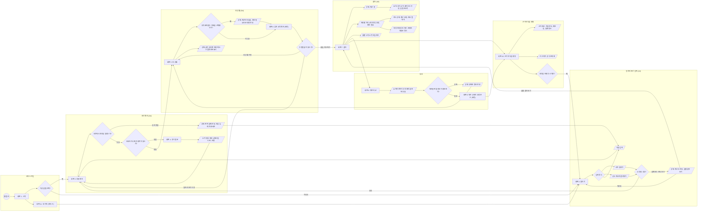

# 한끗 유저플로우 (수정본)

화면은 11개이고, 안내·로딩·보류는 별도 화면이 아니라 해당 화면 안의 상태로 표시한다.

## 시연 시나리오별 경로

**A. 구직촉진수당을 받는 훈련생이 주말 카페 알바 공고 사진을 올린다**
시작 → 올리기(사진) → 추출 확인 → 내 상황(구직촉진수당: 예) → 입력 요약 → 결과(수당 감액, 일해도 총수입이 늘지 않는 구간) → 대안 비교(수당이 유지되는 최대 근무시간) → 대안 상세와 요청 문구 → 근거와 다음 행동

**B. 부모의 피부양자인 대학생이 "3.3% 떼고 지급" 제안 메시지를 붙여 넣는다**
시작 → 올리기(붙여넣기) → 추출 확인(사업소득으로 판별) → 내 상황(피부양자: 예, 부양가족: 예) → 입력 요약 → 결과(피부양자 기준과 부모 공제 기준을 넘는 달) → 대안 비교(넘지 않는 근무 조건) → 근거와 다음 행동

**C. 급여 지급 방식이 적히지 않은 공고를 올린다**
시작 → 올리기 → 추출 확인(소득 종류: 확인 필요) → 추가 질문(지급 방식 되묻기) → 추출 확인 → 내 상황(그 밖의 지원: 청년월세지원 선택) → 상태: 계산하지 않음, 확인 필요와 문의처 안내 → 입력 요약 → 결과(해당 제도는 지원 범위 외 카드로 표시)

## 예외 흐름
| 상황 | 처리 |
|---|---|
| 사진에서 조건을 읽지 못함 | 추출 확인 화면 안에서 안내하고 직접 입력으로 전환 |
| 소득 종류를 판별할 수 없음 | 추가 질문 화면에서 되묻기. "모름"이면 관련 제도는 확인 필요로 표시 |
| 규칙표에 없는 제도 | 계산하지 않고 확인 필요와 문의처 안내 |
| AI 호출 실패 또는 한도 초과 | 재시도 안내와 샘플 결과 보기. 샘플 결과는 가상 사례임을 표시 |
| 대안을 만들 정보가 부족 | 대안을 만들지 않고 부족한 정보를 안내 |
